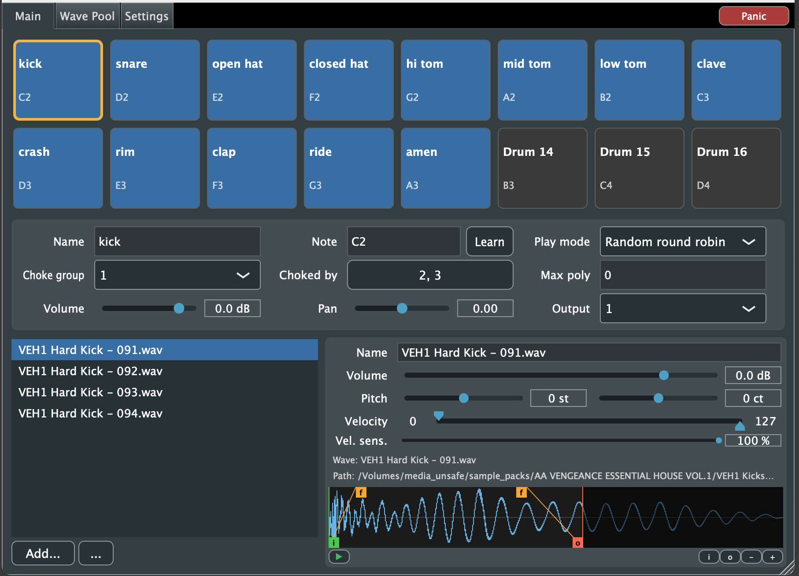

# DrumHits

A drum sampler built with C++ and [JUCE](https://juce.com), shipping as VST3, AU (macOS) and standalone. See [DESIGN_V2.md](DESIGN_V2.md) for the design.

**Status:** largely complete and functional. WAV is currently the supported sample format.



## Prerequisites

- Git
- CMake 3.22 or newer
- A C++20 compiler
  - macOS: Xcode or the Command Line Tools (`xcode-select --install`)
  - Windows: Visual Studio 2022 with the C++ workload
  - Linux: GCC or Clang plus JUCE's dependencies (see the
    [JUCE Linux dependencies](https://github.com/juce-framework/JUCE/blob/master/docs/Linux%20Dependencies.md))

## Setup

JUCE and Catch2 are git submodules:

```
git clone <repo-url> drumhits
cd drumhits
git submodule update --init
```

## Build

```
cmake -S . -B build -DCMAKE_BUILD_TYPE=Debug
cmake --build build -j8
```

Use `-DCMAKE_BUILD_TYPE=Release` for an optimized build. On Windows and with other multi-config generators, pass `--config Release` to `cmake --build` instead.

With MSVC, Release builds statically link the C/C++ runtime (`/MT`) by default,
so these binaries do not require the Visual C++ Redistributable. Debug and
other configurations retain the dynamic runtime. This does not eliminate
dependencies on Windows system DLLs. Reconfigure and rebuild existing outputs
when changing runtime settings.

Outputs are in `build/DrumHits_artefacts/<config>/`:

- `Standalone/DrumHits.app` (macOS) or the standalone executable
- `VST3/DrumHits.vst3`
- `AU/DrumHits.component` (macOS only)

Plugins are not installed automatically. Copy the VST3 or AU to your plugin folder, or point your host at the build folder.

### Windows local code signing

For use on another Windows machine you control, you can sign the standalone
executable and the executable inside the VST3 bundle with a self-signed
certificate. This is opt-in; normal builds remain unsigned. The Windows SDK
must be installed with Visual Studio (including `signtool.exe`).

On the build machine, in PowerShell, create the certificate once:

```powershell
New-Item -ItemType Directory -Force build\signing
powershell.exe -NoProfile -ExecutionPolicy Bypass -File .\scripts\New-SigningCertificate.ps1 -CertificatePath .\build\signing\DrumHits.cer
```

The execution policy override applies only to this PowerShell process. Save the
printed thumbprint. The non-exportable private key remains in the
current Windows user's personal certificate store on this machine; keep that
account secure. The `.cer` file contains only the public certificate and can be
copied to the other machine. Do not generate a new certificate for every build:
the other machine would need to trust each replacement. Losing the private key
requires creating and trusting a new certificate.

Configure and build with the same Windows account that created the certificate:

```powershell
cmake -S . -B build -DDRUMHITS_WINDOWS_SIGNING=ON -DDRUMHITS_SIGNING_CERT_SHA1=<thumbprint>
cmake --build build --config Release --target DrumHits_Standalone DrumHits_VST3
```

Replace `<thumbprint>` with the 40-character value, without angle brackets.
Signing runs after linking, so when enabling signing or changing signing
settings in an existing build, use `--clean-first` on the build command to
ensure both binaries are signed with the current settings.
Signing failures fail the build. If the Windows SDK is installed in a
nonstandard location, set `-DDRUMHITS_SIGNTOOL="C:\path\to\signtool.exe"`.
By default no timestamp is added, so signatures expire with the certificate.
An RFC 3161 timestamp server can optionally be configured with
`-DDRUMHITS_TIMESTAMP_URL=https://your-timestamp-server`; it must be reachable
at build time. Certificate trust and timestamp validation still depend on the
destination machine.

On the other machine, first verify the certificate's SHA-1 thumbprint through a
separate trusted channel against the value printed on the build machine:

```powershell
certutil -dump .\DrumHits.cer
```

Only if it matches and you trust this signing key, import the public certificate
into **Current User** > **Trusted Root Certification Authorities** and
**Current User** > **Trusted Publishers** (run these in PowerShell):

```powershell
Import-Certificate -FilePath .\DrumHits.cer -CertStoreLocation Cert:\CurrentUser\Root
Import-Certificate -FilePath .\DrumHits.cer -CertStoreLocation Cert:\CurrentUser\TrustedPublisher
```

Trusting a self-signed root grants trust to signatures from that key, not just
this particular build. Never copy or share the private key; remove the
certificate from both trust stores if the key is compromised or no longer
needed. These imports affect only the current user.

Copy the standalone executable or the **entire** `DrumHits.vst3` folder to the
other machine. To check a signature there, right-click the executable (or the
`.vst3` binary inside `Contents\<architecture>-win`) and inspect **Properties >
Digital Signatures**, or run `Get-AuthenticodeSignature <path-to-binary>` and
check for `Status : Valid`. A valid, locally trusted signature identifies the
publisher and detects changes to the signed binary; it does not guarantee that
Microsoft Defender, SmartScreen, or other security products will not warn or
quarantine it. SmartScreen reputation is separate from local certificate
trust. For public distribution, use a certificate from a recognized code
signing authority and follow Microsoft's reputation guidance instead.

## Usage

1. Launch the standalone app and configure audio and MIDI devices, or load the plugin in a host and route MIDI to it.
2. In **Wave Pool**, use **Add...** or drag in WAV files. Select a wave to preview it and optionally select a portion in the waveform. Use **To drum...** beside the play button to add that portion, or the whole wave, as a hit.
3. On **Main**, select a drum and assign its MIDI note. Add more hits using **Add...**, then edit their properties and waveform start, end and fades. Play the assigned note to trigger the drum; use the play button to preview a hit.
4. In **Settings**, save or load a patch. When saving, you can purge unused waves or consolidate the waves into a subfolder beside the patch. Use **Search Missing** in Wave Pool to locate missing files.

The plugin provides four stereo outputs; select an output for each drum on Main and enable additional buses in your host as needed.

## Tests

```
cmake --build build --target DrumHitsTests
ctest --test-dir build --output-on-failure
```

Skip building tests with `-DDRUMHITS_BUILD_TESTS=OFF`.

## License

DrumHits is licensed under the [GNU General Public License, version 3 or later](LICENSE) (GPL-3.0-or-later). Third-party dependencies have their own licenses. In particular, JUCE modules are available under the AGPLv3 or a commercial license; see [JUCE's license](external/JUCE/LICENSE.md) for its terms.

## Layout

- `src/core/` - UI-independent engine and controller, built as `drumhits_core`
- `src/` - JUCE plugin processor and editor
- `tests/` - Catch2 unit tests
- `external/` - JUCE and Catch2 submodules
