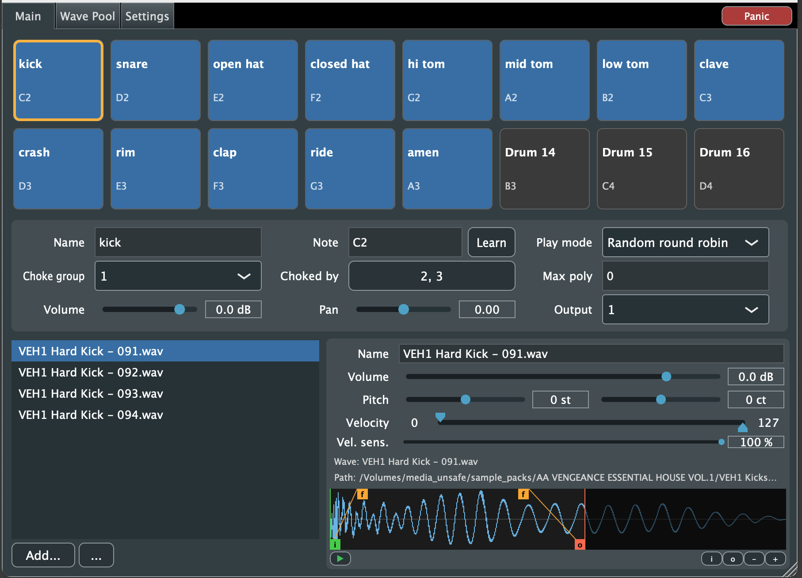

# DrumHits

A drum sampler built with C++ and [JUCE](https://juce.com), shipping as VST3, AU (macOS) and standalone. See [DESIGN_V2.md](DESIGN_V2.md) for the design.

**Status:** largely complete and functional. WAV is currently the supported sample format.



## Prerequisites

- Git
- CMake 3.22 or newer
- A C++20 compiler
  - macOS: Xcode or the Command Line Tools (`xcode-select --install`)
  - Windows: Visual Studio 2022 with the C++ workload
  - Linux: GCC or Clang plus JUCE's dependencies (see the
    [JUCE Linux dependencies](https://github.com/juce-framework/JUCE/blob/master/docs/Linux%20Dependencies.md))

## Setup

JUCE and Catch2 are git submodules:

```
git clone <repo-url> drumhits
cd drumhits
git submodule update --init
```

## Build

```
cmake -S . -B build -DCMAKE_BUILD_TYPE=Debug
cmake --build build -j8
```

Use `-DCMAKE_BUILD_TYPE=Release` for an optimized build. On Windows and with other multi-config generators, pass `--config Release` to `cmake --build` instead.

Outputs are in `build/DrumHits_artefacts/<config>/`:

- `Standalone/DrumHits.app` (macOS) or the standalone executable
- `VST3/DrumHits.vst3`
- `AU/DrumHits.component` (macOS only)

Plugins are not installed automatically. Copy the VST3 or AU to your plugin folder, or point your host at the build folder.

## Usage

1. Launch the standalone app and configure audio and MIDI devices, or load the plugin in a host and route MIDI to it.
2. In **Wave Pool**, use **Add...** or drag in WAV files. Select a wave to preview it and optionally select a portion in the waveform. Use **To drum...** beside the play button to add that portion, or the whole wave, as a hit.
3. On **Main**, select a drum and assign its MIDI note. Add more hits using **Add...**, then edit their properties and waveform start, end and fades. Play the assigned note to trigger the drum; use the play button to preview a hit.
4. In **Settings**, save or load a patch. When saving, you can purge unused waves or consolidate the waves into a subfolder beside the patch. Use **Search Missing** in Wave Pool to locate missing files.

The plugin provides four stereo outputs; select an output for each drum on Main and enable additional buses in your host as needed.

## Tests

```
cmake --build build --target DrumHitsTests
ctest --test-dir build --output-on-failure
```

Skip building tests with `-DDRUMHITS_BUILD_TESTS=OFF`.

## License

DrumHits is licensed under the [GNU General Public License, version 3 or later](LICENSE) (GPL-3.0-or-later). Third-party dependencies have their own licenses. In particular, JUCE modules are available under the AGPLv3 or a commercial license; see [JUCE's license](external/JUCE/LICENSE.md) for its terms.

## Layout

- `src/core/` - UI-independent engine and controller, built as `drumhits_core`
- `src/` - JUCE plugin processor and editor
- `tests/` - Catch2 unit tests
- `external/` - JUCE and Catch2 submodules
